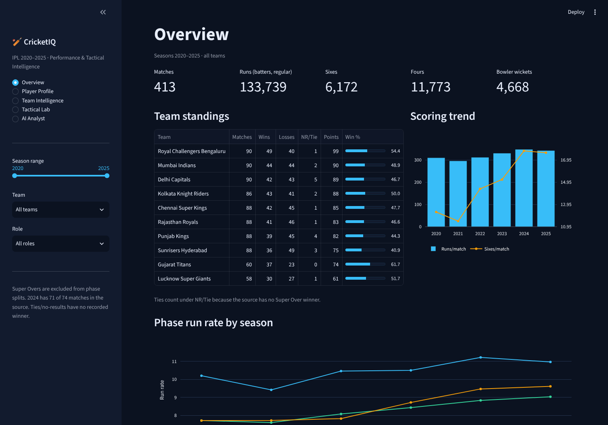
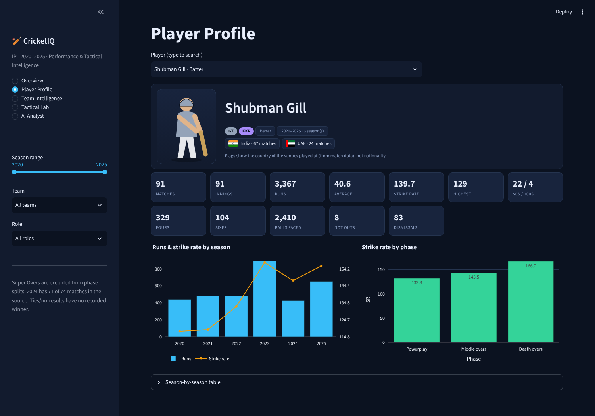
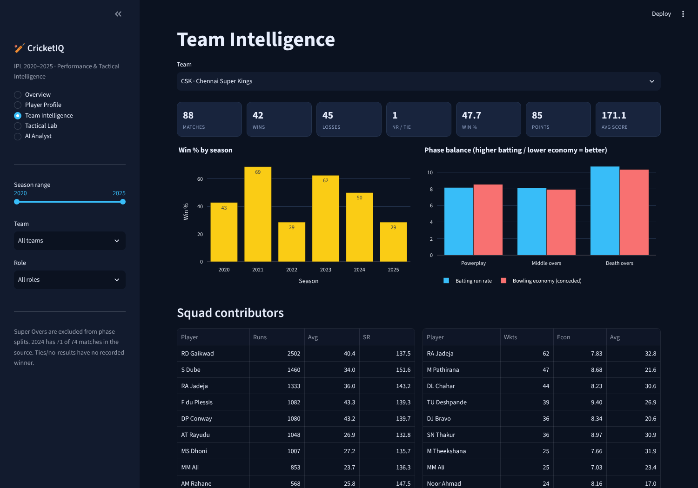
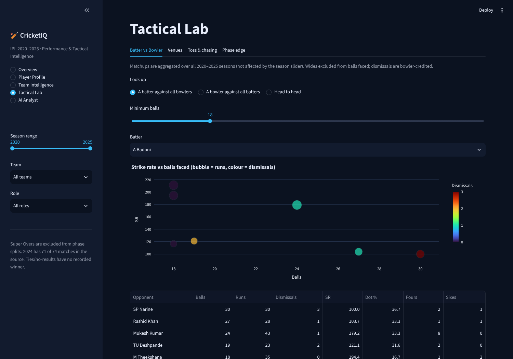
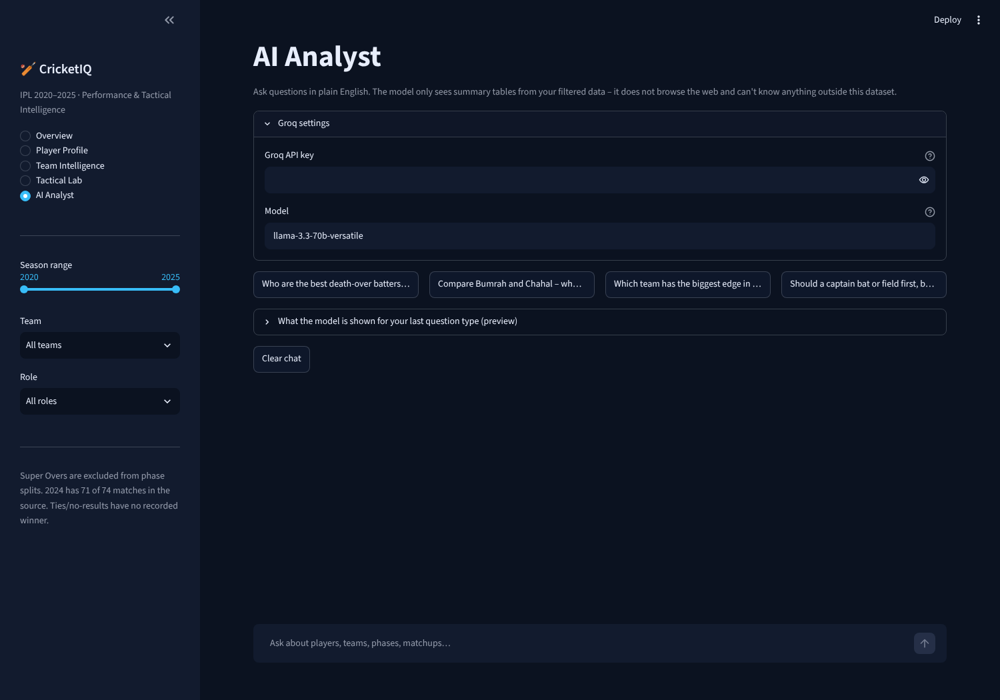

# CricketIQ – IPL Performance & Tactical Decision Intelligence

An interactive analytics app for IPL 2020–2025. Explore teams, players, phases and matchups, and ask questions in plain English through an AI analyst.

Built with **Python · Streamlit · Plotly · pandas · Groq API**.



## Features

| Page | What it does |
|---|---|
| **Overview** | Season KPIs, team standings, scoring trend, phase run rates, top run-scorers and wicket-takers |
| **Player Profile** | Pick any player: avatar (batter or bowler), teams played for, venue-country flags, stat cards, season and phase charts |
| **Team Intelligence** | Win % by season, batting vs bowling balance across Powerplay / Middle / Death overs, squad contributors |
| **Tactical Lab** | Batter vs bowler matchups, venue scoring and chase tendencies, toss impact, phase-edge heatmap |
| **AI Analyst** | Ask questions in natural language; answers are grounded in summary tables built from your current filters |

Sidebar filters (season range, team, role) apply across the app.

## Screenshots

| Player Profile | Team Intelligence |
|---|---|
|  |  |

| Tactical Lab | AI Analyst |
|---|---|
|  |  |

## Dataset

IPL ball-by-ball data for 2020–2025 (413 matches, 99,147 deliveries), prepared from the [Cricsheet](https://cricsheet.org) archive. Please check Cricsheet's licence and credit them when you share this project.

Notes on the data:
- Season "2020" is the 2020/21 edition played in the UAE.
- 2024 has 71 of 74 scheduled matches in the source.
- Tied and no-result matches have no recorded winner and appear as NR / Tie.
- Super Overs are excluded from phase splits and rate statistics.
- Franchise renames (Kings XI Punjab → Punjab Kings, Royal Challengers Bangalore → Bengaluru) and duplicate stadium names are merged.
- Flags on player profiles show the country of the venues a player appeared at (India or UAE). The dataset has no nationality information.
- Small samples are flagged. Matchup figures are exploratory, not statistically significant.

## Run locally

Requires Python 3.10+.

```bash
pip install -r requirements.txt
streamlit run app.py
```

On Windows you can also double-click `run.bat`. The app opens at http://localhost:8501.

## AI Analyst setup (Groq)

1. Create an API key at [console.groq.com](https://console.groq.com).
2. Copy `.env.example` to `.env` and set `GROQ_API_KEY`.
3. Optionally set `GROQ_MODEL` (default `llama-3.3-70b-versatile`) and `MAX_QUESTIONS_PER_SESSION` (default 10).

The model only receives summary tables built from the filtered data and is instructed to answer from them alone. Never commit your `.env` file.

## Deploy on Streamlit Community Cloud

1. Push this repository to GitHub.
2. On [share.streamlit.io](https://share.streamlit.io) choose **Create app**, select the repository, branch `main` and main file `app.py`.
3. Under **Advanced settings → Secrets** add:
   ```toml
   GROQ_API_KEY = "your_key_here"
   GROQ_MODEL = "llama-3.3-70b-versatile"
   ```
4. Deploy. The key stays server-side and is never sent to visitors' browsers.

## Project structure

```
├── app.py                # Streamlit application
├── prepare_data.py       # Builds data/*.csv from the Excel workbook
├── player_countries.py   # Optional nationality map (empty)
├── data/                 # Prepared datasets used by the app
├── assets/               # README screenshots
├── .streamlit/config.toml
├── requirements.txt
├── .env.example
└── run.bat / run.sh
```

## Rebuild the data

```bash
pip install openpyxl
python prepare_data.py "CricketIQ_IPL_2020_2025_Ready_For_PowerBI.xlsx"
```

## Limitations

- Historical data only: no injuries, form, pitch reports, fielding or bowling-style data.
- Insights describe past performance and are not predictions.
- Team colours are neutral accents, not official branding. No logos or player photos are used.

## Author

Your Name · [GitHub](https://github.com/your-username) · [LinkedIn](https://linkedin.com/in/your-profile)
